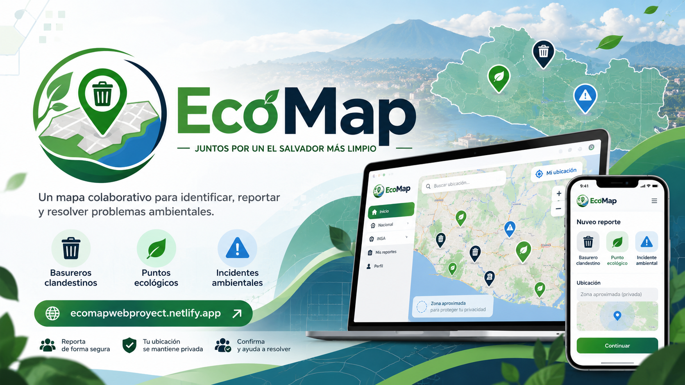
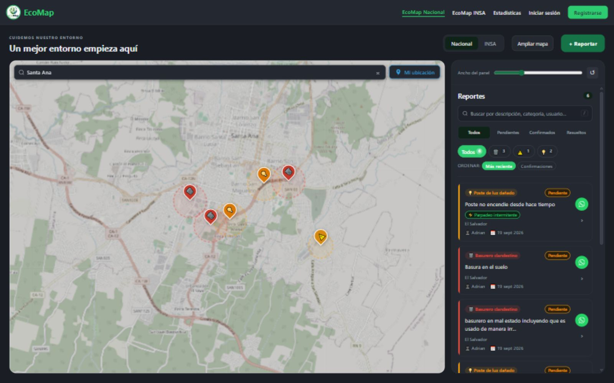
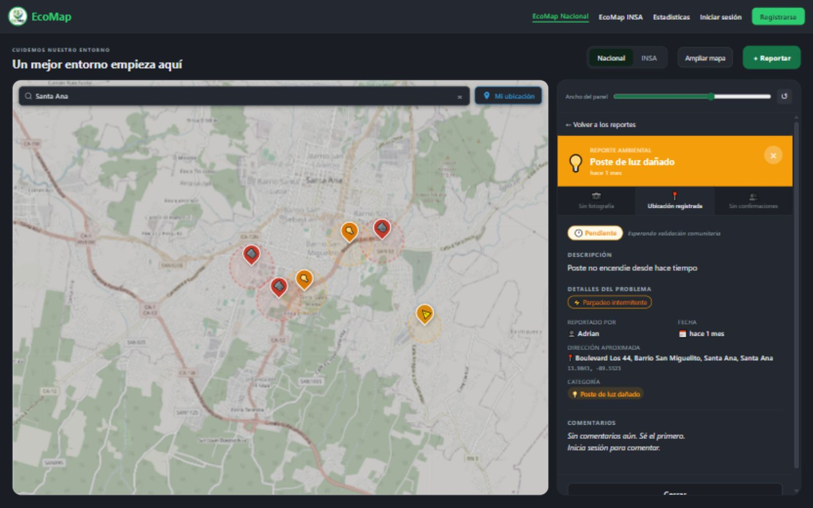
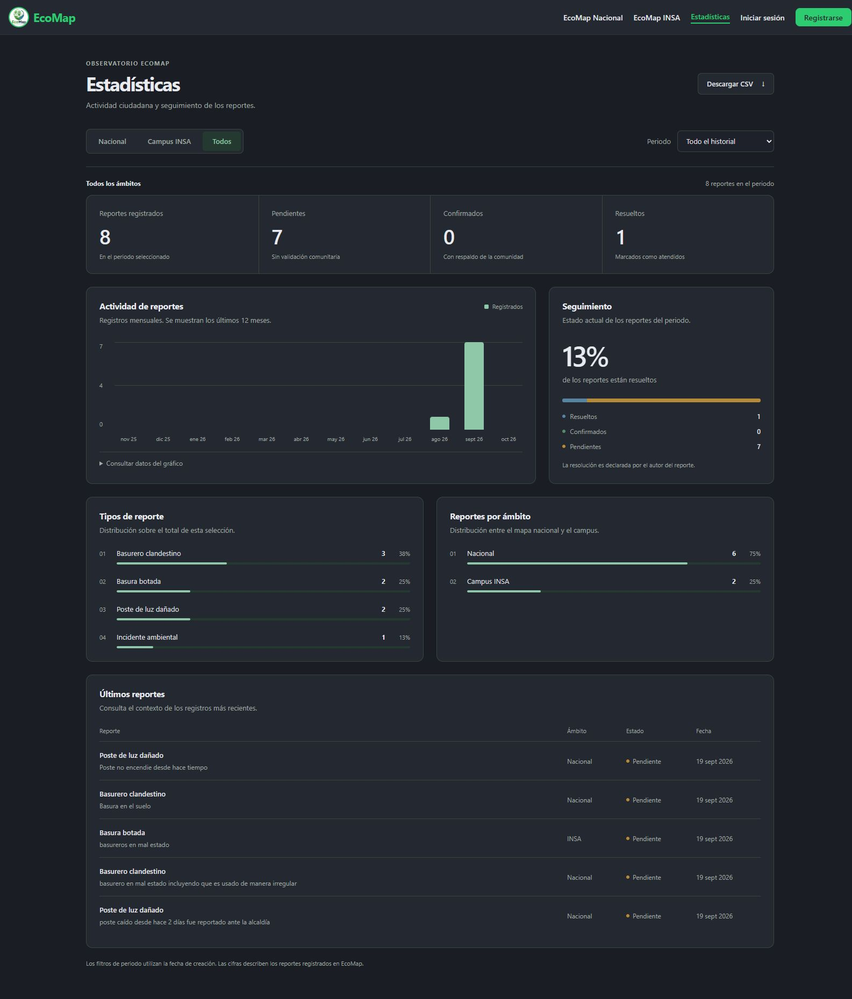
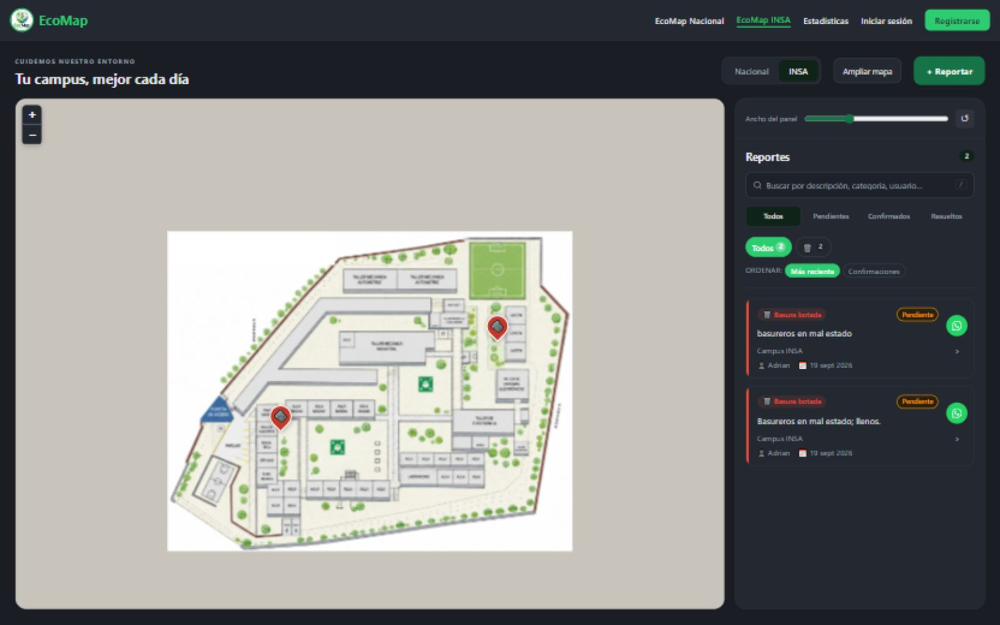
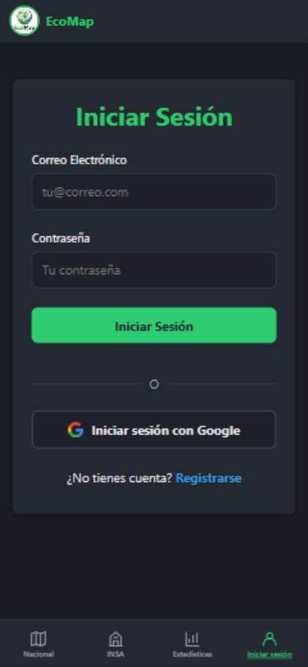
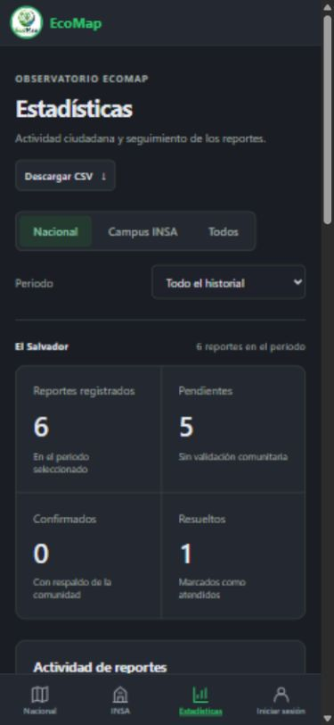

<div align="center">
  
  <h1>EcoMap</h1>
  <p>Reportes ciudadanos para cuidar el entorno de El Salvador.</p>
  <p>
    <a href="https://ecomapwebproyect.netlify.app">Abrir aplicación</a> ·
    <a href="https://github.com/Akiyama93-INF/EcoMap-Web/releases">Releases</a> ·
    <a href="CHANGELOG.md">Historial de cambios</a>
  </p>
</div>

EcoMap permite **ubicar, documentar y dar seguimiento a problemas ambientales y de infraestructura**. Combina un mapa nacional con un plano independiente del **Instituto Nacional de Santa Ana (INSA)**, reportes con fotografías, confirmaciones comunitarias y estadísticas.

Se puede explorar sin cuenta. Para crear reportes, confirmar problemas o comentar, se necesita iniciar sesión.



*Mapa nacional en la web publicada, centrado en Santa Ana. Captura real del 24 de octubre de 2026. Datos cartográficos: © [colaboradores de OpenStreetMap](https://www.openstreetmap.org/copyright).*

**React 18 · Vite · Leaflet · Firebase · Cloudinary · Capacitor 8**

[Capturas](#capturas) · [Funciones](#funciones) · [Instalación](#instalación) · [Comprobaciones](#comprobaciones) · [Despliegue](#despliegue) · [Android](#android) · [Documentación](#documentación)

## Capturas

Todas las imágenes se tomaron directamente de [la aplicación publicada](https://ecomapwebproyect.netlify.app) el **24 de octubre de 2026**. Muestran datos y controles reales, sin montajes ni cuentas de demostración. Las cifras pueden cambiar con la actividad de la comunidad.

<details>
<summary><strong>Detalle de un reporte junto al mapa</strong></summary>



El panel de escritorio permite leer el reporte y consultar su estado sin perder el contexto del mapa. Su ancho es ajustable.

</details>

<details>
<summary><strong>Estadísticas y seguimiento</strong></summary>



El panel reúne periodos, ámbitos, evolución temporal y estados actuales. La selección se puede descargar como CSV.

</details>

<details>
<summary><strong>Plano del campus INSA</strong></summary>



El campus utiliza coordenadas del plano y reportes propios; sus posiciones no se mezclan con las coordenadas GPS del mapa nacional.

</details>

### En teléfono

<table>
  <tr>
    <th align="center">Acceso a EcoMap</th>
    <th align="center">Estadísticas</th>
  </tr>
  <tr>
    <td align="center"></td>
    <td align="center"></td>
  </tr>
</table>

Las vistas móviles son capturas del navegador con un área de **390 × 844 px**. No son capturas del APK. Las de escritorio utilizan un área de **1600 × 1000 px**; la imagen de estadísticas captura la página completa.

## Funciones

| Área | Qué permite hacer |
| --- | --- |
| Mapa nacional | Explorar reportes en El Salvador, buscar lugares y centrar el mapa en la ubicación del dispositivo. |
| Campus INSA | Consultar y reportar sobre el plano institucional con Leaflet `CRS.Simple`. |
| Reportes | Elegir categoría y subtipos, describir el problema, ubicarlo y adjuntar una foto JPG, PNG o WebP de hasta 5 MB. |
| Comunidad | Confirmar reportes de otras personas, comentar y compartir enlaces por WhatsApp. |
| Escritorio | Consultar detalles en un panel lateral, ajustar su ancho y ampliar el mapa. |
| Móvil | Alternar el espacio dedicado a mapa y lista, con navegación inferior y detalle adaptado. |
| Estadísticas | Filtrar por ámbito y periodo, consultar evolución y seguimiento, y descargar la selección en CSV. |
| Perfil | Editar nombre y foto, consultar contribuciones y buscar o filtrar el historial propio. |
| Cuenta | Registrarse con correo y contraseña o iniciar sesión con Google. |
| Android | Integración con cámara, Google Auth nativo y notificaciones mediante Capacitor. |

La interfaz adapta su tema a la preferencia del sistema. Las páginas principales se cargan bajo demanda y los reportes se actualizan mediante suscripciones de Firestore.

### Categorías

**Nacional:** basurero clandestino, punto ecológico, incidente ambiental, río contaminado, poste de luz dañado, chorro público dañado, tubería dañada y obstrucción vial.

**INSA:** basura botada.

### Seguimiento comunitario

| Estado mostrado | Significado |
| --- | --- |
| Pendiente | Reporte sin confirmaciones comunitarias y que no se ha marcado como resuelto. |
| Confirmado | Reporte con confirmaciones o un estado confirmado previamente registrado. |
| Resuelto | Su autor lo ha marcado como atendido. |

La presentación interpreta también los estados históricos de los datos. Una confirmación expresa respaldo comunitario; la resolución declarada por el autor no equivale a una verificación externa.

### Cómo se leen las estadísticas

- Ámbitos **Nacional**, **Campus INSA** y **Todos**.
- Todo el historial o últimos **30, 90 y 365 días**, según la fecha de creación y la hora de El Salvador.
- Estados actuales de los reportes de la selección; no son un conteo de resoluciones realizadas durante ese periodo.
- Gráfico diario para 30 días y mensual para los demás periodos. La vista histórica muestra los últimos 12 meses del gráfico.
- Departamentos basados en el dato registrado, sin inferir fronteras mediante rectángulos. Los reportes sin departamento se identifican como tales.
- Los registros sin fecha solo forman parte del total histórico, no del gráfico temporal.

Consulta los [criterios de cálculo y el diseño del perfil](docs/analytics-profile-update.md).

## Tecnologías

| Capa | Herramientas |
| --- | --- |
| Interfaz | React 18, React Router DOM, CSS y variables de tema |
| Desarrollo y compilación | Vite 4, ESLint y pruebas con `node:test` |
| Mapas | Leaflet, React Leaflet y OpenStreetMap; plano PNG para INSA |
| Búsqueda y direcciones | Nominatim |
| Autenticación y datos | Firebase Authentication y Cloud Firestore |
| Imágenes | Cloudinary |
| Android | Capacitor 8, cámara, push notifications y Google Auth nativo |
| Web publicada | Netlify |

El mapa nacional usa tiles de OpenStreetMap; el tema oscuro se aplica con estilos sobre esa capa.

## Instalación

### Requisitos

- **Node.js 22 o superior**, requerido por la CLI de Capacitor incluida en el proyecto.
- npm.
- Un proyecto Firebase y configuración de Cloudinary para utilizar los servicios.
- Android Studio únicamente para trabajar en la versión Android.

### 1. Obtener el código e instalar dependencias

```bash
git clone https://github.com/Akiyama93-INF/EcoMap-Web.git
cd EcoMap-Web
npm ci --legacy-peer-deps
```

Se utiliza `--legacy-peer-deps` para respetar el árbol de dependencias del proyecto, que combina Capacitor 8 con el plugin de Google Auth. Netlify emplea la misma opción en `netlify.toml`.

### 2. Configurar el entorno

Copia [`.env.example`](.env.example) a `.env` y completa los valores de tu proyecto:

```env
VITE_FIREBASE_API_KEY=
VITE_FIREBASE_AUTH_DOMAIN=
VITE_FIREBASE_PROJECT_ID=
VITE_FIREBASE_STORAGE_BUCKET=
VITE_FIREBASE_MESSAGING_SENDER_ID=
VITE_FIREBASE_APP_ID=

VITE_CLOUDINARY_CLOUD_NAME=
VITE_CLOUDINARY_UPLOAD_PRESET=
```

Las imágenes se suben a Cloudinary. `VITE_FIREBASE_STORAGE_BUCKET` pertenece a la configuración de Firebase; no determina dónde se guardan las fotos de los reportes.

Las variables `VITE_*` se incorporan al cliente durante la compilación. No deben contener claves privadas, credenciales de servicio ni secretos de servidor. El archivo `.env` está excluido de Git.

La preparación de Firebase, autenticación y permisos se detalla en [Configuración de servicios](docs/services-setup.md).

### 3. Ejecutar

```bash
npm run dev
```

Abre la dirección que indique Vite, normalmente [localhost:5173](http://localhost:5173).

## Comprobaciones

| Comando | Función |
| --- | --- |
| `npm run lint` | Revisa el código JavaScript y JSX. |
| `npm test` | Ejecuta las pruebas de filtros, estados, fechas, estadísticas y CSV. |
| `npm run build` | Genera la versión de producción en `dist/`. |
| `npm run preview` | Sirve localmente la compilación generada. |

Antes de enviar un cambio:

```bash
npm run lint
npm test
npm run build
```

Las pruebas automatizadas se complementan con una revisión en escritorio y teléfono. Los cambios de autenticación, fotos o escritura de datos deben comprobarse con una cuenta de prueba; el APK requiere una revisión en dispositivo.

## Despliegue

Netlify compila la aplicación con `npm run build`, publica `dist/` y reescribe las rutas para React Router. La configuración está en [`netlify.toml`](netlify.toml).

Flujo utilizado para la web:

1. Trabajar en una rama y abrir un pull request.
2. Revisar las comprobaciones y el Deploy Preview de Netlify.
3. Fusionar los cambios aprobados en `main`.
4. Comprobar el despliegue de producción y el sitio público.

Las variables de entorno deben configurarse también en Netlify para los contextos que correspondan. El archivo `.env` local no se publica como configuración del servicio.

**Publicar la web no actualiza el APK ni despliega reglas de Firebase.** Son procesos independientes.

## Android

El proyecto nativo está en [`android/`](android/). Para sincronizar la web:

```bash
npm run build
npx cap sync android
npx cap open android
```

En Android Studio se puede generar un APK firmado desde **Build → Generate Signed Bundle / APK**. El código incluye integraciones para cámara, permisos de ubicación y notificaciones; Google Auth nativo requiere la configuración correspondiente del proyecto Firebase y la aplicación Android.

Consulta las [publicaciones del repositorio](https://github.com/Akiyama93-INF/EcoMap-Web/releases) para las versiones que el equipo haya distribuido.

## Estructura

```text
EcoMap-Web/
├── android/                 # Aplicación Android con Capacitor
├── docs/                    # Guías y capturas reales del producto
├── public/                  # Logotipo y plano del INSA
├── src/
│   ├── components/          # Mapas, reportes, navegación y perfil
│   ├── context/             # Tema de la interfaz
│   ├── firebase/            # Autenticación, datos, imágenes y notificaciones
│   ├── hooks/               # Estado, suscripciones, GPS y cámara
│   ├── pages/               # Pantallas y rutas
│   ├── styles/              # Estilos de componentes y páginas
│   └── utils/               # Categorías, filtros y cálculos de estadísticas
├── tests/                   # Pruebas de regresión
├── .env.example             # Variables de configuración, sin valores privados
├── capacitor.config.json
├── netlify.toml
├── CHANGELOG.md
└── README.md
```

## Documentación

- [Comodidad en escritorio y compatibilidad móvil](docs/desktop-update.md).
- [Estadísticas, perfil y criterios de cálculo](docs/analytics-profile-update.md).
- [Configuración de servicios y modelo de datos](docs/services-setup.md).
- [Procedencia y actualización de las capturas](docs/screenshots/README.md).
- [Historial de cambios](CHANGELOG.md).

## Contribuir

Abre una propuesta o incidencia en [GitHub Issues](https://github.com/Akiyama93-INF/EcoMap-Web/issues) explicando el problema, el resultado esperado y, si corresponde, cómo reproducirlo.

Para contribuir código, crea una rama, limita el cambio a un objetivo y ejecuta lint, pruebas y compilación. Si cambia la interfaz, incluye capturas de escritorio y móvil. Documenta las nuevas variables o integraciones necesarias sin añadir credenciales al repositorio.

## Equipo y créditos

Proyecto del **Instituto Nacional de Santa Ana (INSA)**, Especialidad **ITSI 2.º H**.

Mapas y datos geográficos de **OpenStreetMap** y sus colaboradores, con Leaflet para su visualización. Las fotografías y descripciones de los reportes corresponden a sus autores. El plano institucional y el logotipo forman parte de los recursos de EcoMap.

**Licencia:** pendiente de documentar en un archivo `LICENSE`; el repositorio no lo incluye actualmente.
